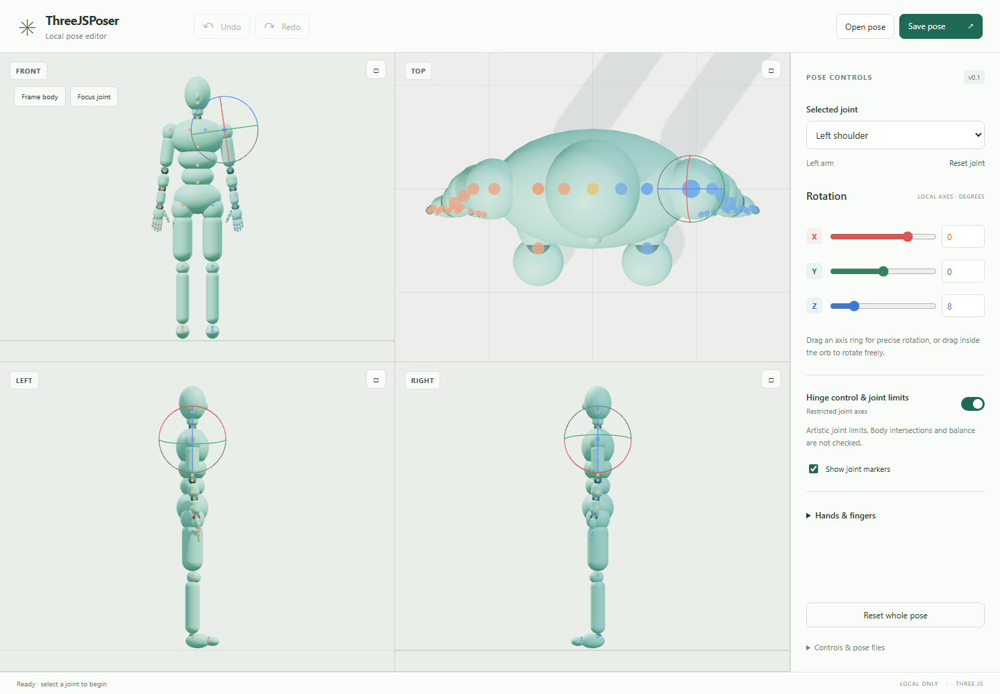
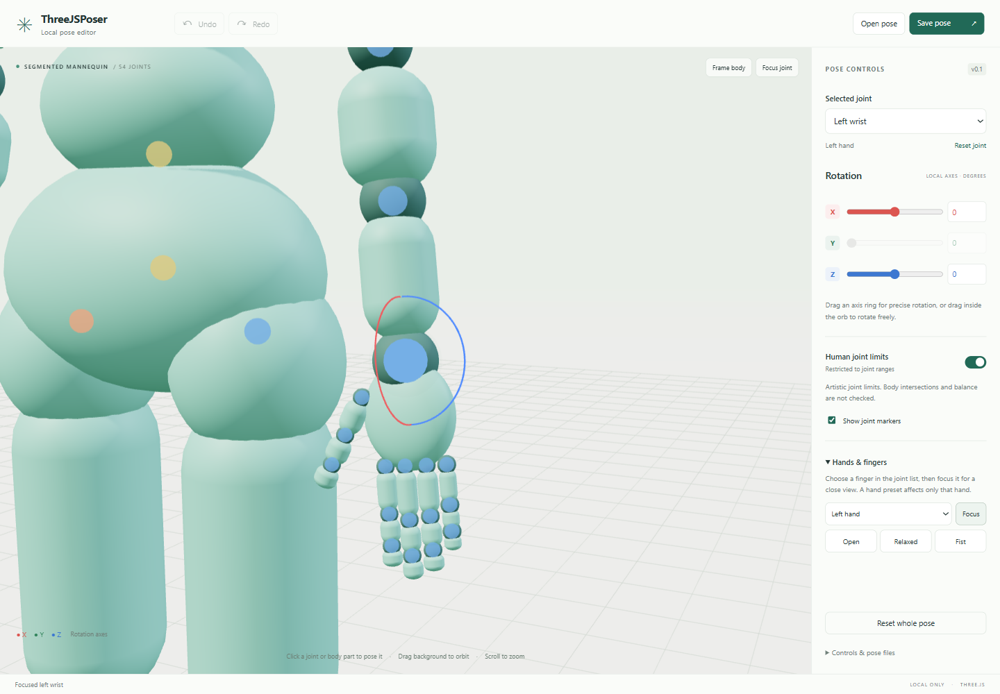

# ThreeJSPoser

ThreeJSPoser is a local 3D pose editor that helps artists create precise visual references for AI image generation. Pose a procedural mannequin, inspect joint angles, and save or share the pose as JSON. It does not generate images itself.

## What it does

- Provides 54 joint controls across the spine, clavicles, forearm twist, fingers, thumbs and toes.
- Lets you pose directly in 3D or set exact local-axis rotations in degrees.
- Supports undo/redo, optional joint limits, hand presets, and JSON pose files.
- Runs locally without model downloads, cloud accounts, telemetry or CDN requests.

Use a saved pose or a screenshot of the mannequin as a visual guide when writing an image prompt or preparing a reference for an AI image tool. The editor does not connect to an AI service.

## Screenshots

## Run on Windows

Requires Node.js 22 or newer.

1. On first setup, run `npm install` in this folder (the pinned dependency is already installed in this working copy).
2. Double-click `start.cmd`, or run `npm start`.
3. Open the URL printed by the server in Chrome. Keep the server terminal open; Ctrl+C stops it.

The server listens only on this computer. After setup, the editor works without an internet connection. If port 5173 is busy, the server automatically tries the next available port and prints its URL.

## Pose controls

- Click a body part or joint marker, or select a joint from the list.
- Drag the red X, green Y or blue Z rotation ring. Drag inside the orb for free rotation. The camera pauses during a rotation drag.
- Use the sliders or numeric degree fields for precise local-axis rotation. Locked axes are hidden on the orb and disabled in the inspector.
- The viewport shows fixed Front, Top, Left, and Right orthographic views. Use the square button on a pane to maximize it, then click again to restore the four-view layout.
- Right-drag in a view to pan, and scroll to zoom.
- **F** focuses the selected joint; **Home** frames the entire mannequin. The Hands & fingers section includes a close view and three hand presets.
- **Ctrl+Z / Ctrl+Shift+Z** undo/redo. Each rotation drag is one undo step. **Esc** cancels an active rotation drag.
- Reset one joint or the entire pose. Both operations can be undone.

## Limits and their scope

Human joint limits can be switched on or off. Enabled limits clamp each joint's local XYZ angles to conservative artistic ranges. Elbows and knees are hinges; forearm pronation/supination has a separate control. Turning limits on also clamps an existing unrestricted pose and can be undone.

These are approximate, independent angular limits. They **do not guarantee a physically possible whole-body pose**: coupled anatomical constraints, self-collision, ground contact and balance are not simulated. This version uses direct joint rotation, not limb IK or animation playback. It is an editor foundation, not a finished game engine.

## Pose files and data protection

**Save pose** downloads a timestamped JSON file. **Open pose** reads a file you select and validates its format, rig identity, joints, size and numeric values before replacing the in-memory pose. Opening a valid pose is undoable. Invalid files leave the current pose intact. No pose is written automatically; closing or reloading the page discards unsaved work.

Pose records contain a version, rig identifier, limits setting and local XYZ rotations in degrees. The rest hierarchy lives in `src/rig.js`; body geometry lives in `src/mannequin.js`. Future rig changes should introduce a new rig identifier or explicit migration.

**Export Complete Pose** downloads `pose-export.json` with rest/current transforms,
the full hierarchy, primitive geometry, materials, Front/active cameras and the
procedural JavaScript source. See [the complete export format](POSE-EXPORT.md)
for reconstruction instructions and visual scope. Existing pose files remain compatible.

## Compact implementation

- `src/rig.js`: rig definition, joint limits and pose validation, independent of the renderer.
- `src/history.js`: isolated snapshots for undo/redo.
- `src/mannequin.js`: procedural body geometry and render hierarchy.
- `src/main.js`: Three.js scene, controls and editor interactions.
- `server.mjs`: localhost-only static server with an explicit file allowlist; no write API.

## Tests

After `npm install`, run `npx playwright install chromium` once to install the browser used by the integration tests. Run `npm test` for the unit and browser suites. The browser tests verify WebGL rendering, four-view maximize/restore, joint picking and gizmo rotation in each view, and undo/redo. The test server uses port 4173; set `CI=1` in CI environments to disable reuse of an existing server.

Temporary browser files and dependency caches belong in the ignored `work/` folder.

Three.js is MIT-licensed; its license is in `node_modules/three/LICENSE`. The mannequin is generated by the code in this project; no JustSketchMe assets or source were used.

## AI training

Are you a beginner in AI? Get trained. Contact: [albertcapacitaciondigital@gmail.com](mailto:albertcapacitaciondigital@gmail.com).

## License

Original ThreeJSPoser source, documentation, and screenshots are licensed under [Creative Commons Attribution 4.0 International (CC BY 4.0)](https://creativecommons.org/licenses/by/4.0/). Third-party components keep their own licenses; Three.js is MIT-licensed.
